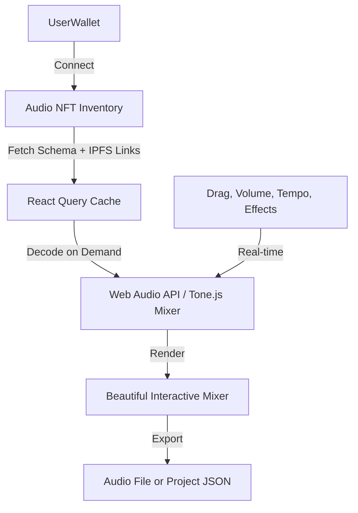

# wax-audio-nft-playlist-remixer — Audio NFT Playlist Remixer & Client-Side Mixer

> **Status:** 🔒 Private (In Development) | Target Public Release: August 2026  
> **Category:** Spatial Audiovisual Web & Interactive Multi-Media Players  
> **Parent Catalog:** [pixel-journey/wax-ecosystem-blueprint-catalog](https://github.com/pixel-journey/wax-ecosystem-blueprint-catalog)

**One-sentence goal:** An in-browser dynamic audio console that reads tracks, stems, and loops directly from user-owned Audio NFTs (via schema-linked IPFS files), allowing collectors to mix, layer, adjust tempo, apply effects, and create/share custom playlists entirely client-side using the Web Audio API.

---

## 1. Overview & Goal

This blueprint turns passive Audio NFT ownership into an active creative experience. Collectors can remix their own tracks without uploading anything or relying on centralized servers.

- **Why it matters for WAX:** Audio NFTs are growing on WAX. Giving owners real creative tools increases engagement, perceived value, and community remixing culture.
- **Public infrastructure only:** AtomicAssets for schema + asset data, IPFS gateways for audio files, Web Audio API + Tone.js or native for mixing. No custom contracts or backend audio processing.
- **Target users:** Audio NFT collectors, musicians, DJs, generative artists, community remix events.
- **Success metrics:** "Load and start mixing my Audio NFTs in <5s", "Create and export shareable remixes client-side", "Beautiful, intuitive interface that feels like a pro DAW lite".

---

## 2. Concepts & Inspiration

- **Core concepts:** Audio NFTs store metadata pointing to audio files (stems, full tracks, loops) on IPFS. Schemas can define track type, BPM, key. Client fetches and decodes audio for real-time mixing.
- **Pain points:** Most Audio NFTs are "listen only". Owners want to create with them. Centralized remix tools defeat the ownership spirit.
- **Inspirations:** Ableton Live / GarageBand lite, Soundtrap, browser-based DAWs like Amped Studio, traditional playlist makers. Web3 twist: 100% client-side from on-chain owned assets.
- **Cross-references:** Pairs beautifully with `wax-generative-art-seed-canvas`, `wax-spatial-audio-3d-soundscape`, `wax-audio-visualizer-frequency-bars`, and any generative/creative blueprints. Complements innovative Category 2 and 5 (performance).

---

## 3. Design Specifications (Pixel Journey Standards)

### 3.1 Visual & Interaction Design
- Clean modern DAW-inspired interface: waveform visualizers, track lanes, mixer panel, transport controls.
- Dark theme with vibrant accent colors for playheads and waveforms.
- Micro-interactions: Drag-and-drop tracks from inventory, real-time waveform scrubbing, smooth fader movements with framer-motion.
- Responsive: Full desktop experience; touch-friendly mobile mixer mode.
- Loading states: Progressive audio decoding with skeleton waveforms.

### 3.2 Key Views / Components
- `AudioInventoryPanel.tsx` — Sidebar showing user's Audio NFTs with waveform previews.
- `MixerCanvas.tsx` — Main multi-track mixer with lanes, volume/pan/effects per track.
- `TransportControls.tsx` — Play/pause, tempo slider, metronome, record/export.
- `EffectRack.tsx` — Simple client-side effects (EQ, reverb, filter) using Web Audio nodes.
- `PlaylistExporter.tsx` — Export mix as audio file or shareable project JSON (with asset references).

### 3.3 Accessibility (A11y) & Inclusive Design
- WCAG 2.2 AA: Keyboard-accessible controls, screen reader announcements for transport and track changes, high contrast waveforms.
- Alternative text-based mixer view for low-vision users.
- Reduced motion option.

### 3.4 Performance & Optimization Targets
- Fast initial load via lazy audio decoding.
- Efficient Web Audio graph management (limit concurrent decoded tracks).
- Bundle size optimized; heavy audio processing in Web Workers where possible.
- Lighthouse 90+ on desktop.

---

## 4. Technical Architecture

### 4.1 Core Tech Stack
- Next.js 15 + TypeScript + Tailwind + shadcn/ui + framer-motion
- Web Audio API + Tone.js for high-level mixing and effects
- @tanstack/react-query for asset fetching
- AtomicAssets SDK or direct REST for schema + metadata
- wavesurfer.js or custom canvas for waveforms

### 4.2 Data Flow Diagram (Mermaid)


### 4.3 Folder Structure
```
app/
├── (mixer)/page.tsx
├── components/
│   ├── mixer/
│   │   ├── MixerCanvas.tsx
│   │   ├── TransportControls.tsx
│   │   └── EffectRack.tsx
│   └── inventory/
│       └── AudioInventoryPanel.tsx
├── hooks/
│   ├── useAudioNFTs.ts
│   └── useMixer.ts
├── lib/
│   ├── audio/
│   │   ├── decoder.ts
│   │   └── mixer-engine.ts
│   └── wax/
│       └── atomic-audio-parser.ts
├── types/audio.ts
public/
└── mock-audio/          # Sample stems for demo mode
```

### 4.4 Security & Privacy
- All audio processing and mixing happens 100% client-side in the browser.
- No audio files uploaded. Only public IPFS references from owned NFTs.
- Export is local or user-initiated.

---

## 5. Implementation Examples & Code Snippets

**Core mixer hook (simplified)**
```ts
// hooks/useMixer.ts
export function useMixer() {
  const [tracks, setTracks] = useState<Track[]>([]);
  const audioContext = useRef(new AudioContext());

  const addTrack = async (asset: AudioNFT) => {
    const audioBuffer = await decodeAudioFromIPFS(asset.audioUrl);
    const track = createTrackNode(audioContext.current, audioBuffer);
    setTracks(prev => [...prev, track]);
  };

  return { tracks, addTrack, /* play, stop, setVolume, etc. */ };
}
```

**Waveform + mixing UI example**
```tsx
<WaveSurfer
  audioUrl={track.url}
  onReady={handleReady}
  options={{ waveColor: '#4f46e5', progressColor: '#6366f1' }}
/>
```

---

## 6. Demo & Testing Strategy
- **Demo Mode:** Preloaded sample Audio NFT stems (no wallet needed).
- **Live Mode:** Connect wallet → load real owned Audio NFTs → mix live.
- **Export test:** Create mix → export WAV or project file with asset references.
- **Playwright + Vitest:** Transport controls, drag-and-drop, real-time parameter changes, performance under load.

---

## 7. Roadmap & Development Phases
**Phase 0-1:** Scaffold + Web Audio foundation + Atomic schema parser for audio assets.
**Phase 2:** Core mixer UI (tracks, faders, waveforms, transport) + basic effects.
**Phase 3:** Advanced features (tempo sync, looping, playlist management, export).
**Phase 4:** Polish, a11y, performance optimization, full documentation.

**Future Enhancements:**
- Integration with `wax-spatial-audio-3d-soundscape` for 3D positioning.
- Collaborative remixing (share project JSON).
- On-chain remix registration (optional).
- Mobile PWA support.

---

## 8. Visual References & Mockups
> Modern browser DAW meets beautiful Web3 interface. Think Ableton Live lite + SoundCloud waveform polish, but fully owned by your NFTs. Clean dark theme, vibrant interactive elements, intuitive drag-and-drop from inventory. Reference: Amped Studio, Soundtrap, or high-quality browser music tools.

Example layout:
[ Inventory Sidebar with your Audio NFTs ]
[ Main Mixer: Multiple track lanes with waveforms + volume/pan ]
[ Transport bar + Tempo + Effects rack ]
[ Export/Share buttons ]

---

## 9. Related Blueprints & Ecosystem Fit
- `wax-generative-art-seed-canvas` — Pair visual generative art with audio remixing.
- `wax-spatial-audio-3d-soundscape` — Extend mixing into immersive 3D space.
- `wax-audio-visualizer-frequency-bars` — Real-time visualizers during mixing.
- Performance & IPFS optimization blueprints (Category 5).

---

## 10. License, Contributing & Credits
- MIT License
- Built with ❤️ for creative Audio NFT experiences on WAX using only public infrastructure and client-side tech.
- Special thanks to Web Audio API, Tone.js community, and Atomic Hub for reliable schemas.
- Pixel Journey Design System for consistent beautiful components.

**This blueprint transforms Audio NFT ownership from passive listening into active, joyful creation — 100% client-side and on-chain verifiable.**

---

**Pixel Journey — Beautiful interfaces for public blockchain data.**
